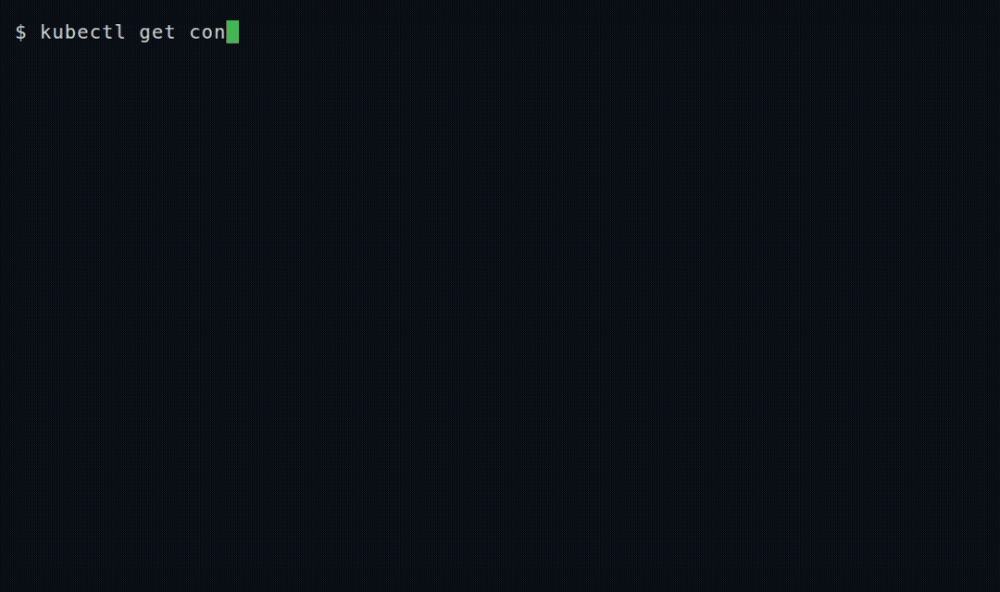

<p align="center"></p>

# Zen Cleaner

[](https://github.com/zenmesh/zen-cleaner/releases/latest)
[](https://github.com/zenmesh/zen-cleaner/actions/workflows/ci.yml?query=branch%3Amain)
[](https://opensource.org/licenses/Apache-2.0)
[](go.mod)
[](docs/compatibility/kubernetes.md)
[](https://github.com/zenmesh/zen-cleaner/pkgs/container/charts%2Fzen-cleaner)

Kubernetes gives built-in TTL cleanup to **Jobs only**. For ConfigMaps, Secrets,
Pods, ReplicaSets, CRDs and everything else you write bespoke controllers — or
let clutter accumulate. **zen-cleaner** closes that gap with plain YAML policies:
declare a TTL and a selector, and a small controller deletes matching objects
when they expire. **Dry-run first**, rate-limited, observable via Kubernetes
events and Prometheus metrics. **Independent Apache-2.0 OSS** — it does not
require Zen Mesh (or any hosted service).

**60-second overview** ([1:16](https://www.youtube.com/shorts/i4I0RDWZnFw)) ·
**Longer walkthrough** ([6:35](https://www.youtube.com/watch?v=7MgDgQ53zeU))


*Real screen recording (~18s, with the reconcile wait cut): disposable cluster,
published `0.1.20` chart and image, typed commands with live outputs — the expired temp
ConfigMaps are removed and everything else survives.*

## Quick start

**1. Install** — the released chart pins the released image by digest. This
first command already authorizes ConfigMap cleanup in `default` (the example
policy below targets ConfigMaps; Jobs are the other default-validated kind):

```bash
helm upgrade --install zen-cleaner \
  oci://ghcr.io/zenmesh/charts/zen-cleaner --version 0.1.20 \
  --namespace zen-cleaner-system --create-namespace \
  --set rbac.targetKinds[0].group=batch --set rbac.targetKinds[0].resource=jobs \
  --set-string rbac.targetKinds[1].group= --set-string rbac.targetKinds[1].resource=configmaps \
  --set rbac.deleteNamespaces[0]=default
```

Upgrading from 0.1.19? Apply the updated CRD and re-check policies in
`dryRun` first — see the [CHANGELOG](CHANGELOG.md) for the upgrade notes and
the deletion-safety changes in 0.1.20.

**2. Apply a minimal policy — dry-run first.** Create `policy.yaml`:

```yaml
apiVersion: cleaner.zen-mesh.io/v1alpha1
kind: ZenCleanerPolicy
metadata:
  name: cleanup-temp-configmaps
  namespace: default        # a USER namespace (the release namespace is safety-protected)
spec:
  targetResource:
    apiVersion: v1
    kind: ConfigMap
    namespace: default      # explicit namespace required by policy schema
    labelSelector:
      matchLabels:
        temporary: "true"
  ttl:
    secondsAfterCreation: 3600
  behavior:
    maxDeletionsPerSecond: 10
    dryRun: true            # START HERE: match and report, delete nothing
```

```bash
kubectl apply -f policy.yaml
```

**3. Observe, then enable deletion.** Each reconciliation emits Kubernetes
events — dry-run reports candidates and deletes nothing:

```bash
kubectl get events --field-selector reason=PolicyEvaluated | tail -1
# Evaluated policy: matched=N, deleted=0, pending=…
```

When the candidate list is exactly what you expect, flip `dryRun: false`
(`kubectl patch zencleanerpolicy cleanup-temp-configmaps --type merge -p
'{"spec":{"behavior":{"dryRun":false}}}'`), and watch
`reason=PolicyExecutionReceipt` events for the deletion receipt.

An object can always be made permanently invisible to every policy with the
exclusion label `zen-cleaner.zen-mesh.io/exclude: "true"`.

**Deletion safety.** Every controller-issued delete binds the observed UID and
resourceVersion, and the governing policy is re-read uncached at delete time: a
resource replaced after the decision, or a policy disabled/edited since it, is
not deleted — the API server refuses the stale delete (409) and the controller
records a typed outcome (precondition conflict / policy changed / excluded).
These laws are proven against a **real API server**
(`test/apiserver/`, controller-runtime envtest) — and that suite **runs in CI**
since the envtest binaries were wired into the pipeline, with a fail-closed
guard that fails CI if the real-API tests skip.

## TTL modes

Four TTL modes — fixed, field-based, mapped, relative (details in the
[User Guide](docs/USER_GUIDE.md)):

```yaml
ttl:
  secondsAfterCreation: 604800        # fixed: 7 days after creation
```

```yaml
ttl:
  fieldPath: "spec.ttlSeconds"        # field-based: per-object TTL from its own field
```

```yaml
ttl:                                  # mapped: severity → budget
  fieldPath: "spec.severity"
  mappings:
    CRITICAL: 1814400
    MEDIUM: 604800
  default: 604800
```

```yaml
ttl:
  relativeTo: "status.lastProcessedAt" # relative: from any timestamp field
  secondsAfter: 86400
```

## Supported environments

Validated under **enforced default NetworkPolicy** on k3s (kube-router)
v1.35.5 and v1.37.0 — API reach, leadership, TTL cleanup, dry-run, exclusions,
RBAC denials — and on **kind (upstream Kubernetes v1.36.1) + Calico v3.28.2**
(single-node, webhook disabled). Cilium and other CNIs are **not validated**.
Validated resource kinds: Pod, ReplicaSet, ConfigMap, Secret, Job; CRDs are
supported by the API but not validated end-to-end. Full matrix, evidence
links, and troubleshooting:
**[docs/compatibility/kubernetes.md](docs/compatibility/kubernetes.md)**.

## Advanced install

- **From a clone (development / air-gapped):**
  `helm install zen-cleaner ./deploy/helm/zen-cleaner --namespace zen-cleaner-system --create-namespace --set image.tag=<version> --set rbac.deleteNamespaces[0]=default`
  (pin by digest once chosen: `--set image.digest=sha256:…` — the digest wins over the tag).
  Requires Go 1.27.4+ and a container build; see BUILD_REQUIREMENTS.md.
- **Raw kubectl:** the manifests under `deploy/manifests/` contain `${WEBHOOK_NAMESPACE}` and an
  unsubstituted image reference — use the install script (`CLEANER_IMAGE=… WEBHOOK_NAMESPACE=…
  bash deploy/install.sh`), not raw `kubectl apply`. The validating admission webhook requires
  TLS; the Helm path runs with the webhook disabled (validation from the CRD schema alone).
  Recommended webhook path: cert-manager + `deploy/webhook/validating-webhook.yaml` — see
  [docs/WEBHOOK_TLS.md](docs/WEBHOOK_TLS.md).
- **Example policies:** [examples/](examples/) — completed Jobs, evicted Pods, failed Pods,
  old Secrets/Deployments/ReplicaSets, temp ConfigMaps, test Pods.

## Documentation

[User Guide](docs/USER_GUIDE.md) · [API Reference](docs/API_REFERENCE.md) ·
[Compatibility](docs/compatibility/kubernetes.md) ·
[Version compatibility](docs/VERSION_COMPATIBILITY.md) ·
[Architecture](docs/ARCHITECTURE.md) · [Claims and maturity](docs/claims.md) ·
[Evidence index](docs/evidence/README.md) · [Contributing](CONTRIBUTING.md) ·
[Governance](GOVERNANCE.md) · [Maintainers](MAINTAINERS.md) · [Releasing](RELEASING.md)

**Status:** free community OSS (0.x, alpha maturity) — actively maintained,
Apache-2.0; not an official product launch. **Source of truth:** this
repository. **Independent:** zen-cleaner does not require
[Zen Mesh](https://zen-mesh.io), and Zen Mesh does not require zen-cleaner;
the `cleaner.zen-mesh.io` API group is this project's own CRD naming.

**Security:** report vulnerabilities to
[security@zen-mesh.io](mailto:security@zen-mesh.io) or via
[GitHub Security Advisories](https://github.com/zenmesh/zen-cleaner/security)
— see [SECURITY.md](SECURITY.md). Issues and questions: the
[issue tracker](https://github.com/zenmesh/zen-cleaner/issues).

## References

- [Kubernetes TTL-after-finished](https://kubernetes.io/docs/concepts/workloads/controllers/ttlafterfinished/)
- [Kubernetes Enhancement Proposals](https://github.com/kubernetes/enhancements)
- AI context: [llms.txt](llms.txt)
